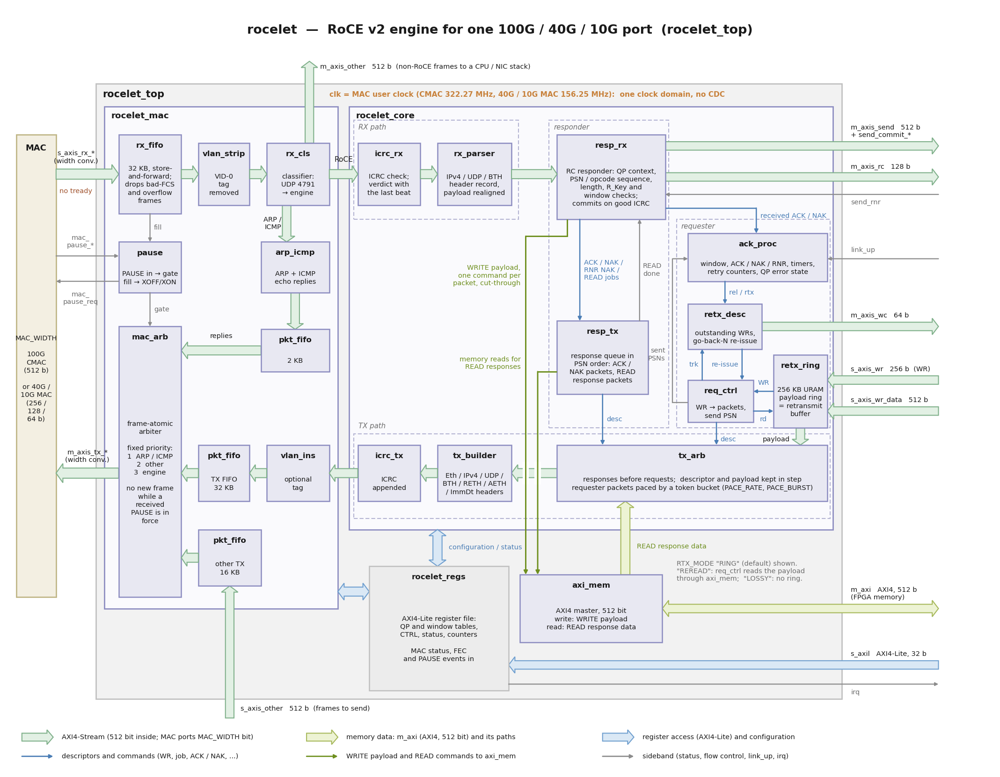

# rocelet

**rocelet** is an open-source, lightweight **RoCE v2** (RDMA over Converged Ethernet) engine
for FPGAs, written in vendor-neutral SystemVerilog and validated on AMD UltraScale+ (see
[Portability](docs/integration.md#10-portability)). It is built for the common FPGA use case: moving data
at line rate between an FPGA and a host or GPU over a point-to-point 100 GbE link (or, since
v0.3, a 40 GbE or 10 GbE link with a narrower MAC), using standard RDMA NICs (validated with an
NVIDIA ConnectX-6 Dx) on the host side, without a licensed IP core.

## What it does

- **RC (reliable connection) requester:** RDMA WRITE, WRITE with immediate, SEND, SEND with
  immediate, multi-packet messages, go-back-N retransmission with an on-chip retransmit ring
  (or by re-reading FPGA memory). Zero loss against a standard NIC.
- **RC responder:** RDMA WRITE and SEND from the host into FPGA memory, RDMA READ of FPGA
  memory by the host, duplicate and NAK handling, RNR, READ continuation.
- **UC streamer mode** compatible with the NVIDIA Holoscan Sensor Bridge data plane
  (one RETH per packet).
- IPv4/UDP framing, TX and RX ICRC, PMTU 256-4096, 802.1Q priority tags, 802.3x pause
  honoured and generated, CNPs dropped.
- Out-of-band QP setup: a small host helper based on libibverbs exchanges QPN, PSN, rkey and
  buffer addresses with the FPGA over a side channel. No in-band connection manager.
- MAC AXI-Stream of 512 bits (100G CMAC, 322 MHz), 256 bits (40GBASE-R4, 156.25 MHz), 128 bits
  or 64 bits (10GBASE-R, 156.25 MHz), set by `MAC_WIDTH`; the engine is 512 bits inside, the width
  converters are built in. PAUSE timing follows the link speed; a capabilities register tells
  firmware the build. AXI-Lite control; AXI-MM data. 40G and 10G are validated on a ZCU106
  with the open-source [omac](https://omac.ethernetfmc.com) MACs.

On a Kintex UltraScale+ (KCU116) the engine (`rocelet_core`) uses about one third of the LUTs
of AMD's ERNIC IP and 6 % of its block RAM; the complete IP (`rocelet_top`, with the MAC glue,
register file and AXI4 memory master) uses about half of ERNIC's LUTs
([docs/resources.md](docs/resources.md)). It sustains line rate for messages of 2 KB and larger
and has been validated against an independent hardware RoCE v2 NIC.

In numbers, the v0.3.0 IP (16 QPs, 16 memory windows, 16 outstanding READs per QP, 256 KB
retransmit ring, RX ICRC check, MAC glue, register file and AXI4 memory master) uses about
**20.7k LUT, 37 BRAM36, 8 URAM and 1 DSP** on an xcku5p with the 512-bit CMAC and closes timing
at 322 MHz ([docs/resources.md](docs/resources.md)); with a 256-bit / 64-bit MAC at 156.25 MHz on
the ZCU106's xczu7ev it uses 20.8k / 21.3k LUT, with more than 1.2 ns of slack. v0.2.2 was the
same size (20.8k LUT).

## Architecture



How to read the diagram, the receive and transmit paths, the requester and the responder:
[docs/architecture.md](docs/architecture.md).

## Using it

rocelet is meant to be pulled into a design as a git submodule. The reference design is
[qsfp28-fmc-rocelet](https://github.com/fpgadeveloper/qsfp28-fmc-rocelet) (Opsero 2x QSFP28
FMC: 100G on the KCU116, 40G or 10G on the ZCU106; see [docs/designs.md](docs/designs.md)). The `dev` branch holds the work in
progress; `main` holds releases.

A design instantiates `rocelet_top` (or `rocelet_bd` in an IP integrator block design) between
the Ethernet MAC (the 100G CMAC, or a 40G / 10G MAC such as the open-source omac IPs) and its
data: work requests and their payload go in on AXI-Streams, completions
come out; host WRITEs and READs reach FPGA memory through an AXI4 master; a soft CPU configures
the queue pairs through AXI-Lite after exchanging their parameters with the host. Start with
[docs/integration.md](docs/integration.md).

## Documentation

The documentation is hosted at [rocelet.ethernetfmc.com](https://rocelet.ethernetfmc.com)
(built by Read the Docs from the `docs/` folder, which reads the same on GitHub):

| Document | Contents |
|---|---|
| [docs/architecture.md](docs/architecture.md) | block diagram, module hierarchy, receive and transmit paths, reliability, HSB mode, clocking |
| [docs/interface.md](docs/interface.md) | the top-level ports and parameters, the work-request and completion formats |
| [docs/registers.md](docs/registers.md) | the AXI-Lite register map (generated; C header `sw/rocelet_regs.h`) |
| [docs/integration.md](docs/integration.md) | adding rocelet to a design: sources, clocks, MAC settings (CMAC: RS-FEC, pause, no auto-negotiation on AOC; 40G / 10G MACs), memory, firmware bring-up, timing, link loss, portability |
| [docs/roce-subset.md](docs/roce-subset.md) | the RoCE v2 subset implemented, the wire rules, and what is deliberately left out |
| [docs/hsb.md](docs/hsb.md) | Holoscan Sensor Bridge compatibility: the data-plane mode, the control plane and producer in the reference design, future work |
| [docs/host-setup.md](docs/host-setup.md) | host rules: MTU, FEC, neighbour entries, QP attributes, receive queues, ConnectX-6 Dx facts, GPU ring, link flaps and cable pulls |
| [docs/resources.md](docs/resources.md) | synthesis results, build-option costs, the MAC widths |
| [docs/throughput.md](docs/throughput.md) | throughput per MAC width: the rates measured at 100G, 40G and 10G |
| [docs/designs.md](docs/designs.md) | designs using rocelet |
| [sim/README.md](sim/README.md) | the simulation regression and its results |
| [host/README.md](host/README.md) | `rocelet_host` (libibverbs test helper) and `roce_check.py` (packet referee) |

## Repository layout

```
rtl/        the IP (SystemVerilog; rocelet.f lists the sources in compile order)
regs/       the register map source (rocelet_regs.py generates the RTL package, the C header and docs/registers.md)
sw/         rocelet_regs.h for firmware
sim/        Python reference models, xsim testbenches, run_tests.py (make sim)
synth/      out-of-context synthesis / place / route scripts (make synth)
host/       host tools: rocelet_host (C, libibverbs), roce_check.py
docs/       documentation
scripts/    generators (the IP integrator wrapper)
```

## Quick start

```
make sim-quick          # simulation regression, smaller workloads (Vivado xsim + Python 3 with scapy)
make sim                # the full regression
make synth              # OOC synthesis, place and route of the v1 configuration (Vivado)
make -C host && make -C host test     # host tools (libibverbs-dev); the tests need no RDMA device
```

The simulations need Vivado's `xvlog`/`xelab`/`xsim` on the PATH (or `VIVADO_SETTINGS`
pointing at `settings64.sh`) and `pip install scapy`.

## Status

v0.3.0 (2026-11-05); see [CHANGELOG.md](CHANGELOG.md). Validated in the qsfp28-fmc-rocelet design
against an NVIDIA ConnectX-6 Dx at three link speeds:

- **100G** (KCU116 + 2x QSFP28 FMC, CMAC, v0.2.2): 98.0 Gb/s FPGA WRITE with immediate into host
  memory, 96.8 Gb/s host WRITE and 96.6 Gb/s host READ of FPGA memory, go-back-N under injected
  loss, and link loss at the default settings including a real cable pull (14.9 s outage,
  stream resumed ~2 s after the link returned, nothing lost).
- **40G** (ZCU106 + 2x QSFP28 FMC, omac_40g, v0.3.0): 38.7-39.2 Gb/s WRITE, SEND and READ (READ at
  line rate down to PMTU 512), 802.3x PAUSE in both directions.
- **10G** (ZCU106, omac_10g, v0.3.0): 9.4-9.8 Gb/s.

The HSB mode carries a Holoscan Sensor Bridge device data plane into GPU memory with NVIDIA's
HSB 3.0.0 host software (80 Gb/s at 100G, 39.0 Gb/s at 40G). Every figure:
[docs/throughput.md](docs/throughput.md).

## Origin

The feature set was chosen by a measured study of RoCE v2 (protocol decomposition, prior art,
a resource baseline of AMD's ERNIC IP, per-block synthesis costs, whole-design builds and bench tests
against a hardware NIC). The prototype that study produced was then productised into this IP;
the prototype itself is not published.

## Contribute

We strongly encourage community contribution to these projects. Please make a pull request if you
would like to share your work:
* if you've spotted and fixed any issues
* if you've added support for other boards, MACs or host NICs
* if you've extended the RoCE v2 subset or the host tools

Thank you to everyone who supports us!

## About us

This project was developed by [Opsero Inc.](https://opsero.com "Opsero Inc."),
a tight-knit team of FPGA experts delivering FPGA products and design services to start-ups and tech companies.
Follow our blog, [FPGA Developer](https://www.fpgadeveloper.com "FPGA Developer"), for news, tutorials and
updates on the awesome projects we work on.

## License

The sources of this repository are released under the MIT license, see [LICENSE](LICENSE).
