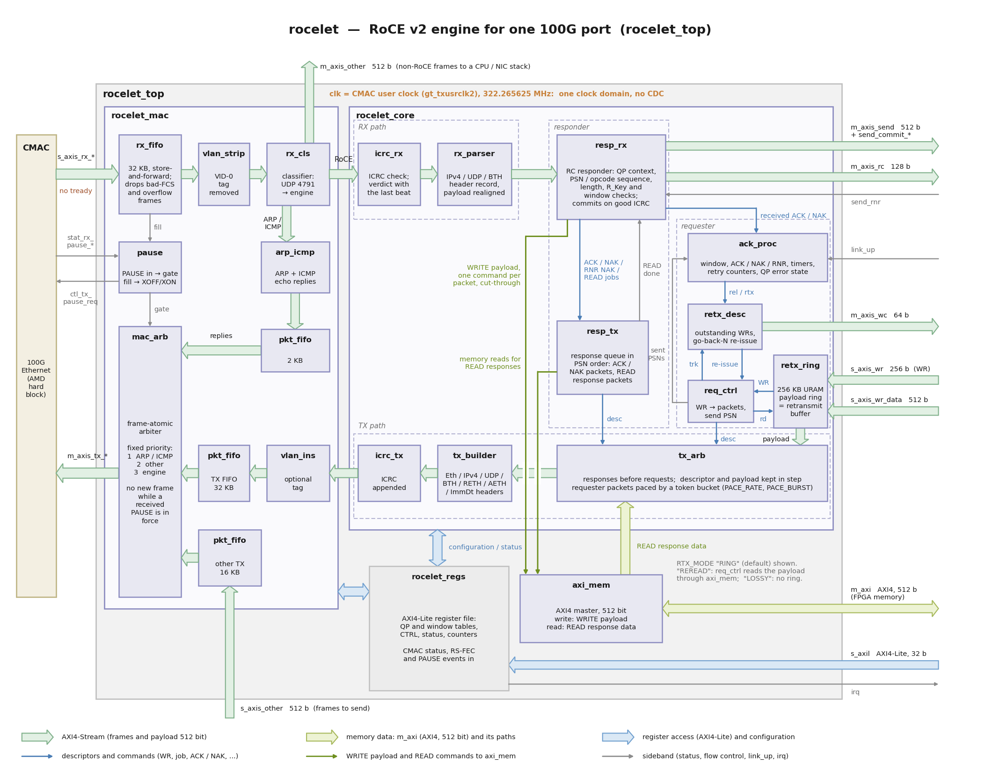

# rocelet architecture

rocelet is a RoCE v2 engine for one 100G Ethernet port: an RC requester (the FPGA writes and
sends into host or GPU memory) and an RC responder (the host writes and sends into FPGA
memory and reads it), with go-back-N reliability, in about one third of the logic of AMD's
ERNIC IP. Everything is SystemVerilog, 512 bits wide, in **one clock domain** (the 100G CMAC
user clock, 322.265625 MHz; 250 MHz also closes), with no vendor IP and no HLS.

## Block diagram

How to read the diagram:

* Blocks are named after their modules without the `rocelet_` prefix (`rx_fifo` is
  `rocelet_rx_fifo`, `axi_mem` is `rocelet_axi_mem`); the three `pkt_fifo` blocks are
  instances of `rocelet_pkt_fifo`. The containers are the hierarchy of `rocelet_top`:
  `rocelet_mac`, `rocelet_core` (with its RX path, TX path, responder and requester groups),
  `rocelet_axi_mem` and `rocelet_regs`. The CMAC on the left is not part of rocelet; the
  external ports are named at the border of `rocelet_top`.
* The **pale green arrows** are AXI4-Streams: Ethernet frames and payload, 512 bits wide
  everywhere inside, and the descriptor ports (`s_axis_wr` 256 bits, `m_axis_rc` 128 bits,
  `m_axis_wc` 64 bits). The **green arrows** are memory data: `m_axi` (AXI4, 512 bits) and
  the READ response data that `axi_mem` returns to `tx_arb`; the **dark green lines** are the
  WRITE payload (one command per packet, cut-through) and the memory read commands of READ
  responses on their way to `axi_mem`. Those two lines pass over the TX path (the gaps in
  the `tx_arb` → `tx_builder` arrow); they do not connect to it. The **blue arrows** are
  register access: `s_axil` into `rocelet_regs` and the configuration and status that it
  exchanges with `rocelet_mac` and `rocelet_core`. The **dark blue thin lines** are
  descriptors and commands, the **grey thin lines** sideband signals (FIFO fill, PAUSE,
  `link_up`, `send_rnr`, `irq`). The orange label is the clock: one domain, the CMAC user
  clock.
* **Receive path** (top row, left to right): the CMAC cannot be back-pressured, so every
  frame goes into the 32 KB store-and-forward `rx_fifo` first (its fill level drives the
  PAUSE requests through `pause`); then `vlan_strip` removes VID-0 priority tags and
  `rx_cls` sends RoCE frames (UDP 4791) to the engine, ARP and ICMP to `arp_icmp`, and
  everything else to `m_axis_other`. In the engine, `icrc_rx` checks the ICRC, `rx_parser`
  extracts the headers and realigns the payload, and `resp_rx` handles the packet.
* **Transmit path** (bottom row, right to left): `tx_arb` takes responses before requests
  and keeps each descriptor and its payload together, `tx_builder` adds the headers,
  `icrc_tx` the ICRC; in the MAC glue `vlan_ins` adds the optional tag and the 32 KB TX
  FIFO holds the whole frame. `mac_arb` sends whole frames only (frame-atomic), ARP/ICMP
  replies first, then other traffic (`s_axis_other`, through a 16 KB FIFO), then the
  engine, and starts no new frame while a received PAUSE is in force.
* **Requester** (right): WRs (`s_axis_wr`) and their payload (`s_axis_wr_data`) go into
  the 256 KB `retx_ring`; a WR is passed to `req_ctrl` once its payload is stored.
  `req_ctrl` cuts it into packets: one descriptor per packet to `tx_arb`, one payload read
  ("rd") from the ring per packet (the payload goes from the ring to `tx_arb`), and one
  tracking record ("trk") per WR to `retx_desc`. It also tells `ack_proc` every PSN it
  sends. ACKs and NAKs received by `resp_rx` go to `ack_proc`, which releases acknowledged
  WRs ("rel") and starts go-back-N retransmissions ("rtx") in `retx_desc`; `retx_desc`
  hands the WRs to re-send back to `req_ctrl` ("re-issue") and emits one work completion
  per WR on `m_axis_wc`, which also frees the WR's payload in the ring.
* **Responder** (middle): `resp_rx` checks each request against the QP context and the
  memory windows, sends WRITE payload to `axi_mem` (`m_axi` writes), SEND payload to
  `m_axis_send` (with the per-packet `send_commit_*` verdict) and receive completions to
  `m_axis_rc`, and queues one job per response (ACK, NAK, RNR NAK or READ) for `resp_tx`.
  `resp_tx` sends them in PSN order: ACK/NAK packets directly, READ responses as packets
  whose data it requests from `axi_mem`, which returns it straight to `tx_arb`; it reports
  each finished READ back to `resp_rx` ("READ done") to free its READ resource.
* **Other traffic** bypasses the engine: `m_axis_other` out of the classifier and
  `s_axis_other` into `mac_arb`, for a CPU or NIC stack (HSB control plane, BOOTP, ...).
* **Registers**: `rocelet_regs` behind `s_axil` holds the configuration (CTRL, local
  addresses, QP and window tables, timers), status and counters (including the CMAC status,
  RS-FEC and PAUSE inputs) and drives `irq`.
* The diagram shows `RTX_MODE` "RING" (the default). With "REREAD" there is no ring:
  `req_ctrl` reads each packet's payload from memory through the second read port of
  `axi_mem`; with "LOSSY" the payload stream goes to `tx_arb` directly and nothing is
  re-sent.

The diagram is generated by `docs/images/gen_block_diagram.py` (Python 3 with matplotlib);
edit and run it after a change to the block structure.

## Module hierarchy

| Module | File | Role |
|---|---|---|
| `rocelet_top` | rtl/rocelet_top.sv | the IP: wires the four parts below; frozen port list (interface.md) |
| `rocelet_regs` | rtl/ctl/rocelet_regs.sv | AXI4-Lite register file (generated map `rocelet_regs_pkg`), QP / window staging and commit, per-QP error causes, counters, irq |
| `rocelet_mac` | rtl/mac/rocelet_mac.sv | MAC glue between the CMAC and the engine |
| `rocelet_rx_fifo` | rtl/mac/ | store-and-forward RX frame FIFO for a MAC without back-pressure; drops bad-FCS / overflow frames whole; fill level |
| `rocelet_vlan_strip`, `rocelet_vlan_ins` | rtl/mac/rocelet_vlan.sv | 802.1Q VID-0 priority tags removed on RX, optional tag on TX |
| `rocelet_rx_cls` | rtl/mac/ | RoCE (UDP 4791) / ARP+ICMP / other-traffic classifier |
| `rocelet_arp_icmp` | rtl/mac/ | ARP and ICMP-echo responder |
| `rocelet_pkt_fifo` | rtl/mac/ | store-and-forward TX FIFOs (no gap inside a frame towards the CMAC) |
| `rocelet_mac_arb` | rtl/mac/ | frame-atomic TX arbiter (ARP/ICMP, other traffic, engine), held by received PAUSE |
| `rocelet_pause` | rtl/mac/ | received PAUSE -> TX gate; RX FIFO level -> `ctl_tx_pause_req` |
| `rocelet_core` | rtl/rocelet_core.sv | the engine with native ports (usable on its own) |
| `rocelet_icrc_rx` / `_tx` / `_mask` | rtl/icrc/ | RoCE v2 ICRC checker and generator (IBTA A17 masks) |
| `rocelet_crc32_core` / `_xor` / `_inv` | rtl/common/ | pipelined 512-bit CRC-32 (one beat per clock, tail stages for partial beats, shared XOR network) |
| `rocelet_rx_parser` | rtl/rx/ | classification, header extraction, payload strip and realignment, end-of-frame verdict |
| `rocelet_resp_rx` | rtl/rx/ | RC responder: PSN / opcode-sequence / length / R_Key checks, WRITE and SEND data paths, ACK / NAK / RNR NAK / READ job requests, READ continuation history, received ACK forwarding |
| `rocelet_resp_tx` | rtl/rx/ | response queue in PSN order: ACK / NAK packets, READ response segmentation, memory read commands |
| `rocelet_req_ctrl` | rtl/tx/ | requester: WR segmentation (RC / UC / HSB), per-QP send PSN, re-issue and lossy-resume control |
| `rocelet_tx_arb` | rtl/tx/ | responses before requests; descriptor and payload kept in step |
| `rocelet_tx_builder` | rtl/tx/ | Ethernet / IPv4 (IPv6) / UDP / BTH / RETH / AETH / ImmDt header builder, payload realignment, per-QP address table |
| `rocelet_ack_proc` | rtl/rc/ | requester window, ACK / NAK / RNR decoding, timers, retry counters, QP error state |
| `rocelet_retx_desc` | rtl/rc/ | outstanding-WR ring: completions, go-back-N re-issue, flush |
| `rocelet_retx_ring` | rtl/rc/ | on-chip payload ring = retransmit buffer for live sources |
| `rocelet_axi_mem` | rtl/mem/ | AXI4 master for the per-packet memory ports |
| `rocelet_fifo`, `rocelet_ram_sdp`, `rocelet_byte_shift`, `rocelet_keep2n` | rtl/common/ | FIFOs, inferred RAMs, byte funnel shifters, keep-to-count |

The source list in compile order is `rtl/rocelet.f`.

## Receive path

1. **RX FIFO** (32 KB, store-and-forward). The CMAC cannot be back-pressured; everything
   behind it can stall. Frames with a bad FCS (CMAC `tuser`) or that do not fit are dropped
   whole. The fill level drives 802.3x PAUSE requests (XOFF at `PAUSE_WM.XOFF`, XON at
   `PAUSE_WM.XON`), so a slow memory or SEND sink slows the link partner instead of losing
   frames.
2. **VID-0 strip**: ConnectX in PCP mode, and some NICs when DCB has several traffic classes,
   send RoCE frames with an 802.1Q priority tag; it is removed. Frames with another VID pass tagged and
   are not RoCE frames for the engine.
3. **Classifier**: UDP 4791 to the engine; ARP and ICMP to the local IP to the responder (or to
   the other-traffic port); everything else to the other-traffic port (HSB BOOTP/ECB control,
   a NIC stack) or dropped.
4. **ICRC check** (`RX_ICRC_EN`): the frame passes through a 16-beat FIFO while the CRC
   pipeline finishes; the verdict travels with the last beat.
5. **Parser**: IPv4 (IHL 5, no fragments, my IP), UDP 4791, BTH TVer 0, an RC/UC opcode it
   knows; CNPs are counted and dropped. One header record per frame, the payload realigned to
   lane 0, and an end-of-frame verdict (ICRC good and length consistent).
6. **Responder** (`rocelet_resp_rx`), one packet at a time: looks up the QP context (ePSN, MSN,
   opcode sequence, running address, residual length, NAK flag), classifies the PSN (new,
   duplicate, out of sequence) and checks everything IBTA asks of an RC responder (opcode
   sequence, PMTU, DMA length, READ depth, R_Key and window bounds, 64-byte alignment). WRITE
   payload goes cut-through to the memory port (one command per packet), SEND payload to the
   SEND stream with a per-packet commit/discard verdict. Only a frame with a good ICRC commits
   the context, produces a receive completion and a response request (ACK, NAK, RNR NAK or a
   READ job). Received ACKs and NAKs go to the requester's ACK processor.
7. **Responses** (`rocelet_resp_tx`) leave in PSN order from one queue sized for every
   outstanding READ (`NUM_QP x READ_DEPTH`), so an ACK never overtakes an earlier READ
   response. READ jobs are segmented into READ RESPONSE FIRST / MIDDLE / LAST / ONLY packets;
   each packet's data is read from memory.

### Duplicate and partial READs (READ continuation)

A duplicate READ (PSN behind ePSN) is re-executed. It carries its own VA, R_Key and length;
they are checked against the window again (a duplicate that fails is dropped). When the
requester lost a READ RESPONSE MIDDLE or LAST, it re-issues the tail of the READ: PSN = the
lost packet's PSN, VA advanced, length reduced. IBTA and Linux rxe answer such a partial
re-issue with a new response (FIRST ... LAST, or ONLY); the ConnectX-6 Dx accepts only a
*continuation* of the original response (MIDDLE ... LAST, or LAST); answered with a new
response it fails the READ (bad response) and its QP goes to error. With `CTRL.READ_CONT` = 1 (reset value `READ_CONT_DEFAULT`, 1) rocelet
answers a duplicate READ whose PSN lies strictly inside an earlier READ of the same QP as a
continuation; a whole re-issue (PSN = the READ's first PSN) is always answered FIRST/ONLY.
The last `READ_DEPTH` READs of every QP are remembered ({first PSN, packets - 1}, one RAM of
`NUM_QP x READ_DEPTH` entries); the lookup scans them one per clock, only for duplicate
READs. The ConnectX-6 Dx needs the continuation too (measured; with 0 it fails the READ with
"bad response"); the bit stays run time.

`READ_DEPTH` limits the *new* READs per QP: a new READ takes a READ resource from its commit
until the last packet of its response is handed to the transmit path. A duplicate READ, whole
or partial, is re-executed without one (its response job is marked as a duplicate and frees
nothing), because the requester counts that READ once, as its original. v0.1 counted the
re-executions too; a ConnectX-6 Dx, which re-issues within microseconds and completes some of
the re-issued READs from the stale responses still in flight, then had a legitimate new READ
NAKed with 0x61. The response queue is shared and back-pressures the receive path when
duplicates fill it.

### RNR NAK

`send_rnr[q]` = 1 means the SEND sink has no buffer for QP q: a SEND FIRST or ONLY arriving on
it is answered with an RNR NAK (timer code `RNR_NAK_TIMER`) and dropped; later packets of the
same message are dropped silently until the requester retries at the NAKed PSN. WRITE with
immediate is never RNR-NAKed by rocelet (its completion goes to `m_axis_rc`, which
back-pressures).

## Transmit path and requester

1. **Work requests** (`s_axis_wr`, interface.md) enter the payload ring (`RTX_MODE` "RING"):
   the WR is forwarded once all of its payload is stored, with its byte offset in the ring as
   the local address. With "REREAD" the WR goes straight in and the payload is read from
   memory per packet; with "LOSSY" the payload stream feeds the builder directly.
2. **`rocelet_req_ctrl`** looks up the QP (next PSN, PMTU, type), records the WR in the
   outstanding-WR ring (the record's acceptance is the window), and segments it into packets:
   one descriptor (and one payload read command) per packet. RC: FIRST / MIDDLE / LAST / ONLY,
   RETH on the first packet of a WRITE, ImmDt on the last packet of an _IMM class, AckReq on
   the last packet and every `ACKREQ_N` packets. UC: the same opcodes | 0x20, no AckReq. HSB:
   see below.
3. **`rocelet_tx_arb`** gives responses priority over requests and keeps each descriptor and
   its payload beats together; the rate limiter (`PACE_RATE`, `PACE_BURST`, a token bucket
   over all QPs) holds requester packets back.
4. **`rocelet_tx_builder`** builds the headers from the per-QP address table (destination MAC,
   IP, QPN, UDP ports, precomputed IPv4 checksum) and the descriptor, and realigns the payload
   behind them (a 4-way byte multiplexer: the header lengths are 54/58/70/74 bytes).
5. **ICRC** appended (`rocelet_icrc_tx`), then the MAC glue: optional VID-0 tag, a 32 KB
   store-and-forward FIFO (the CMAC must not see a gap inside a frame) and the frame arbiter,
   which starts no new frame while a received PAUSE is in force.

### Reliability (go-back-N)

- **`rocelet_ack_proc`** keeps per QP: una (oldest unacknowledged PSN), nxt, retry and RNR
  counters, the time of the last progress, the RNR wait in force, the error state. Events
  (packet sent, ACK/NAK received, configuration, forced error, timer scan) go through one
  read-modify-write pipeline over a context RAM, so the cost grows with `NUM_QP` only by
  memory; a scanner visits one QP per free slot for the ACK timeout and the RNR wait.
- An **ACK** retires every WR it covers (coalesced ACKs). A **NAK sequence error** implies an
  ACK of everything before its PSN and starts a go-back-N re-issue from that PSN. An **RNR
  NAK** implies an ACK of everything before its PSN (never of the PSN itself), then waits the
  time its timer code stands for (IBTA table, 0.01 ms to 655 ms, clamped to
  [`RNR_MIN`, `RNR_MAX`]) and resends from the PSN. A **timeout** resends from una. After
  `RETRY.RETRY_CNT` timeouts or NAK-sequence errors (or `RNR_RETRY` RNR NAKs, 7 = for ever)
  without progress, or a fatal NAK, the QP fails.
- **Link loss** (`link_up`, v0.2): while the link is down and for `LINK_GRACE` ticks after it
  is back, no timeout is counted; a QP whose ACK becomes overdue meanwhile gets an "overdue"
  bit in its context and times out at once when the hold ends (one go-back-N, retry + 1). The
  time base keeps running, so the bit (not the 20-bit time difference, which wraps after
  1.05 s) carries the overdue state through outages of any length. The RNR wait is not held.
  See [integration.md](integration.md) section 9.
- **`rocelet_retx_desc`** holds every outstanding WR (`MAX_WR`) in issue order. A re-issue
  scans it from the oldest record and hands every WR of the QP from the restart PSN on back to
  `rocelet_req_ctrl`, which re-segments it with the original PSNs (RETH only if it restarts at
  the first packet). The payload is read again from the ring (or memory). A WR completes (one
  `m_axis_wc` beat, in WR order) when una passes its last PSN; WRs of a failed QP complete as
  FLUSHED, and the ring frees their payload.
- **"LOSSY"** (lossy resume, experimental): no payload storage; a NAK makes the requester
  continue with new data at the NAKed PSN and a timeout sends a zero-length WRITE probe; the
  lost WRs complete with status LOST. A host NIC that cannot resume inside a message needs WRs
  of at most one packet. `CTRL.LOSS_FATAL` fails the QP at the first loss instead (any mode).
- **UC and HSB QPs** complete a WR when its last packet is sent.

### Holoscan Sensor Bridge (HSB) mode

A QP of type 2 (`HSB_EN`) sends the NVIDIA HSB data-plane format, byte for byte as NVIDIA's
HSB IP (`dp_pkt_top.sv`) builds it:

- every packet of a WRITE or WRITE-with-immediate WR is a UC **RDMA WRITE Only** (0x2A) with its
  own RETH: VA = WR VA + packet offset, DMA length = this packet's payload;
- the last packet of a WRITE-with-immediate WR is **WRITE Only with Immediate** (0x2B); its
  immediate is **{PSN[19:0], imm[11:0]}** (the WR's `imm` bits 11:0 are the frame buffer /
  page index; the host's RoceReceiver takes the page from bits 11:0 and the PSN from 31:12);
- with the WR flag `hsb_md`, the packet that carries the immediate is an HSB **metadata
  record**: rocelet writes {0x00, PSN} (big-endian) into its payload bytes 4..7, the PSN field
  the host compares with the immediate;
- BTH: SE 0, MigReq 0, P_Key 0xFFFF, AckReq 0; IPv4: DSCP/ECN from `IP_HDR.TOS` (keep 0), ID
  0, DF, TTL from `IP_HDR`; UDP checksum 0, source port `QP_UDP.SPORT`, destination port
  `QP_UDP.DPORT` (4791, or the port of HSB's Linux-UDP receiver).

A user module (or firmware) cuts each sensor frame into WRs at page base + offset (any WR size:
every packet is self-describing) and ends it with a 128-byte metadata WR (WRITE with immediate,
`hsb_md` = 1, VA = page base + frame size rounded up to 128). The HSB control plane (BOOTP
enumeration, the ECB register protocol, the `DP_*` registers that carry the host's QP, R_Key
and page ring) is firmware on a soft CPU behind the other-traffic port. See [hsb.md](hsb.md).

## Clocking and reset

One clock, `clk` = the CMAC user clock (`gt_txusrclk2`; the CMAC's RX AXI-Stream is in the
same clock when `rx_clk` is driven from `gt_txusrclk2`, the usual configuration). The
AXI-Lite slave and the AXI4 master run in it too: put a clock converter in front of them when
the CPU or the memory controller is in another domain. `rst` (synchronous, active high) resets
everything including the registers; `CTRL.RESET` resets the engine and the MAC glue but keeps
the registers (the QP and window tables must then be written again). The per-QP context RAMs
are not cleared by a reset: a per-QP "configured" bit gates them, and a QP commit rewrites
them.

## Where the logic comes from

The engine is the research prototype's RTL (Opsero's unpublished study prototype), which
was simulated against independent Python models, run in a KCU116 + OP120 system through a
loopback plug and against a hardware RoCE v2 NIC in all three roles (go-back-N, coalesced ACKs,
RNR, PAUSE both ways). v0.1
adds: per-QP QP type (RC / UC / HSB), the HSB builder mode, READ continuation, RNR NAK
generation, the RNR wait decoded from the AETH, QP error flush and forced error, LOSS_FATAL,
the rate limiter, run-time AckReq interval and retry limits, the register file, the AXI4
memory master and the packaged MAC glue (from the research system), with back-pressure on the
ACK processor's event queues and pipelined WR retirement.
