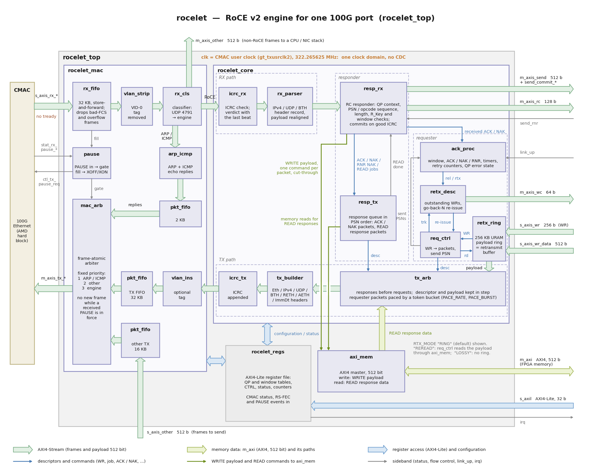

# rocelet

**rocelet** is an open-source, lightweight **RoCE v2** (RDMA over Converged Ethernet) engine
for FPGAs, written in vendor-neutral SystemVerilog, validated on AMD UltraScale+ (see
[Portability](integration.md#10-portability)) and released under the MIT license. It moves data at
line rate between an FPGA and a host or GPU over a point-to-point 100 GbE link, using standard
RDMA NICs (validated with an NVIDIA ConnectX-6 Dx) on the host side, without a licensed IP
core.

Source code, releases and issues: [github.com/fpgadeveloper/rocelet](https://github.com/fpgadeveloper/rocelet).
The first reference design, on the Opsero 2x QSFP28 FMC, is
[qsfp28-fmc-rocelet](https://github.com/fpgadeveloper/qsfp28-fmc-rocelet), documented at
[qsfp28-rocelet.ethernetfmc.com](https://qsfp28-rocelet.ethernetfmc.com).



* **RC (reliable connection) requester:** RDMA WRITE, WRITE with immediate, SEND, SEND with
  immediate, multi-packet messages, go-back-N retransmission from an on-chip retransmit ring.
* **RC responder:** RDMA WRITE and SEND from the host into FPGA memory, RDMA READ of FPGA
  memory by the host, duplicate and NAK handling, RNR, READ continuation.
* **UC streamer mode** compatible with the NVIDIA Holoscan Sensor Bridge data plane.
* IPv4/UDP framing, TX and RX ICRC, PMTU 256-4096, 802.1Q priority tags, 802.3x pause
  honoured and generated; 512-bit AXI-Stream at the 100G CMAC user clock, AXI-Lite control,
  AXI4 memory master.

Start with [](architecture.md) for how the engine works and [](integration.md) for adding it
to a design.

## Contents

```{toctree}
:maxdepth: 2
:caption: Engine

architecture
interface
registers
roce-subset
resources
```

```{toctree}
:maxdepth: 2
:caption: Using rocelet

integration
host-setup
hsb
```

## Elsewhere in the repository

* [README](https://github.com/fpgadeveloper/rocelet#readme): overview, repository layout,
  how to run the regression and the synthesis jobs.
* [CHANGELOG](https://github.com/fpgadeveloper/rocelet/blob/main/CHANGELOG.md): versions,
  what changed and what each version was validated against.
* [sim/README.md](https://github.com/fpgadeveloper/rocelet/blob/main/sim/README.md): the
  simulation regression and its results.
* [host/README.md](https://github.com/fpgadeveloper/rocelet/blob/main/host/README.md):
  `rocelet_host` (the libibverbs test helper) and `roce_check.py` (the packet referee).
